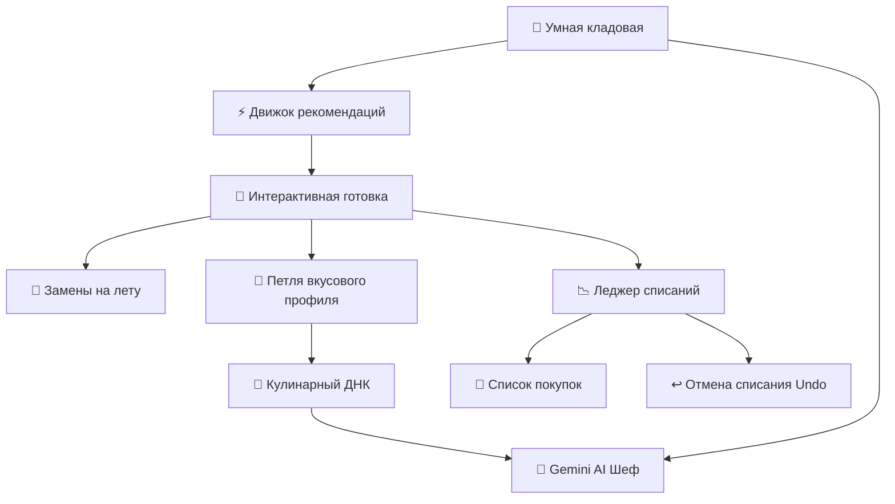

# 🍳 FridgeChef v2 — Руководство по возможностям и архитектуре системы

> **FridgeChef** — это персональный умный кулинарный ассистент, который превращает хаос в холодильнике в ресторанные блюда, адаптированные под вашу физиологию, вкусы и реальные остатки продуктов дома.

---

## 🌟 Философия приложения: Умная кухня без стресса

Традиционные кулинарные трекеры заставляют пользователя вбивать каждый срок годности, граммы и чеки, превращая готовку в бухгалтерский учёт. **FridgeChef v2** построен на совершенно других принципах:

1. **Никакого стресса от сроков годности**: В приложении намеренно нет таймеров порчи и раздражающих пушей. Вы сами видите, что у вас есть и что подходит к концу.
2. **Оценка продуктов «на глаз»**: Человеку в быту проще сказать «осталось полпачки» или «на донышке», чем взвешивать муку на весах.
3. **8 Неприкосновенных базовых продуктов (Staples)**: Соль, масло, сахар, перец, вода, чеснок, соевый соус и мука считаются имеющимися дома по умолчанию, пока вы прямо не нажмёте «Закончился».
4. **Физиология и КБЖУ**: Приложение считает норму калорий на основе вашего роста, веса и активности, а нейросеть Gemini подбирает порции и рассчитывает калории/БЖУ на лету.
5. **Mobile-First интерфейс**: Полная адаптивность для мобильного браузера — приложением удобно пользоваться одной рукой прямо у плиты.

---

## 📱 Ключевые модули и функции FridgeChef v2



---

### 1. 🧬 Кулинарный ДНК и физиологический профиль
*Файл реализации: `backend/app/domain/services/prompt_context_builder.py`, `frontend/src/features/profile/TasteProfileScreen.tsx`*

- **Антропометрия**: Ввод роста, веса, уровня активности и количества приёмов пищи в день.
- **Формула Миффлина-Сан Жеора**: Автоматический расчёт суточной потребности (`daily_kcal`) и целевой калорийности одного приёма пищи (`target_meal_kcal`).
- **Степени сытности**:
  - 🪶 **Лёгкий перекус (`light`)** — ~60% от целевой нормы калорий.
  - ⚖️ **Стандартный приём (`standard`)** — 100% нормы.
  - 🍖 **Сытное блюдо (`hearty`)** — 140% нормы с акцентом на белок.
- **Вкусовая карта**:
  - Чувствительность к соли (умеренная / высокая с авторазбавлением соусов).
  - Предпочтения по соусам (сухое блюдо / умеренный соус / обильный соус).
  - Нелюбимые продукты (AI строго запрещено предлагать их).
  - Аллергены (жёсткий барьер безопасности).
  - Доступное кухонное оборудование (духовка, блендер, вок, мультиварка, гриль).

---

### 2. 🧊 Умная кладовая и 4 зоны хранения
*Файл реализации: `backend/app/presentation/http/api_v1/endpoints/pantry.py`, `frontend/src/features/pantry/PantryScreen.tsx`*

- **4 Зоны хранения**:
  - 🧊 **Холодильник (`fridge`)**: Молочные продукты, овощи, свежее мясо.
  - ❄️ **Морозилка (`freezer`)**: Заморозка, рыба, ягоды, мясные заготовки.
  - 📦 **Шкаф / Бакалея (`pantry`)**: Крупы, консервы, макароны, специи.
  - 🧂 **Базовые запасы (`staples`)**: 8 основных продуктов.
- **Уровни остатков «на глаз» (Fuzzy Levels)**:
  - 🟢 `full` — Полная пачка / запас
  - 🟡 `half` — Примерно половина
  - 🟠 `low` — Мало (включает рецепты из ленты «Добей остатки»)
  - 🔴 `almost_empty` — На донышке (сигнал к закупке)
  - ⚪ `out` — Закончился
- **Быстрое переключение в 1 клик**:
  - Клик по бейджу уровня циклически меняет статус: `full` ➔ `half` ➔ `low` ➔ `almost_empty` ➔ `out`.
  - У базовых продуктов моментальный тумблер «В наличии» / «Закончился».

---

### 3. ⚡ Движок рекомендаций (3 умные ленты)
*Файл реализации: `backend/app/domain/services/recommendation_engine.py`, `frontend/src/features/recipes/RecipesScreen.tsx`*

Умный алгоритм ранжирования взвешивает рецепты по формуле:
$$\text{Score} = 0.45 \cdot \text{Coverage} + 0.25 \cdot \text{FinishLow} + 0.15 \cdot \text{Affinity} + 0.15 \cdot \text{ModeFit} - \infty \cdot \text{Allergens}$$

1. ⚡ **«Готовь прямо сейчас» (`cook_now`)**:
   - 100% ингредиентов есть в холодильнике или базовых запасах.
   - Никаких походов в магазин, можно сразу вставать к плите.
2. 🎯 **«Добей остатки» (`finish_low`)**:
   - Находит блюда, которые эффективно утилизируют продукты с пометкой `low` или `almost_empty`.
   - Помогает освободить полки без выбрасывания еды.
3. 🛒 **«Почти бинго» (`almost_bingo`)**:
   - Рецепты, для которых дома есть $\ge 85\%$ продуктов, а не хватает всего 1–2 позиций.
   - Недостающие ингредиенты добавляются в список покупок кнопкой «В корзину в 1 клик».

---

### 4. 🤖 Gemini AI Генератор авторских рецептов
*Файл реализации: `backend/app/infrastructure/ai/gemini_provider.py`, `frontend/src/features/ai-chef/AIChefScreen.tsx`*

- **Google Gemini API**: Использует новейшие модели Gemini со строгой валидацией Pydantic-схем (`Structured Outputs`).
- **Блок «Почему этот рецепт?» (`why_this_recipe`)**: ИИ аргументирует свой выбор: какие конкретно остатки из вашего холодильника он задействовал и как учёл ваши вкусы.
- **Расчёт КБЖУ**: Нейросеть рассчитывает калории, белки, жиры и углеводы на 1 порцию под целевую сытность.
- **Сохранение в коллекцию**: Сгенерированный рецепт сохраняется в личную базу в 1 клик.

---

### 5. 🍳 Интерактивный кухонный режим готовки
*Файл реализации: `frontend/src/features/cooking/CookingModal.tsx`*

Создан специально для использования на кухне со смартфона, стоящего на подставке:
- **Крупный текст шагов**: Легко читать с расстояния 1–1.5 метра.
- **Встроенный шаговый таймер**: Обратный отсчёт со звуковым сигналом, паузой и сбросом.
- **Чеклист ингредиентов**: Возможность отмечать добавленные продукты по ходу готовки.
- **Мобильные вкладки**: Быстрое переключение между текущим шагом, списком продуктов и полным планом.

---

### 6. 🔄 Замены ингредиентов на лету (AI & Knowledge Graph)
*Файл реализации: `backend/app/presentation/http/api_v1/endpoints/ai.py`*

- Если в процессе готовки или просмотра рецепта выяснилось, что какого-то продукта нет — нажмите кнопку **«Заменить»**.
- Система анализирует **только то, что физически есть в вашей кладовой**, и предлагает точные кулинарные альтернативы с пропорциями и кулинарными советами.
- Замена сразу же отображается в карточке рецепта.

---

### 7. 📉 Леджер списаний и мгновенная отмена (Undo)
*Файл реализации: `backend/app/presentation/http/api_v1/endpoints/inventory_transactions.py`, `frontend/src/features/cooking/CookingModal.tsx`*

- **Двухшаговое превью (`Depletion Preview`)**:
  - По нажатию «Завершить готовку» открывается окно предварительного расчёта списаний.
  - Показывает, сколько граммов/штук спишется с учётом количества порций.
  - Показывает продукты, которые полностью закончатся (`will_deplete`).
  - Позволяет вручную скорректировать списание или исключить продукт.
- **Автопополнение списка покупок**: Обнулившиеся продукты можно в 1 клик отправить в корзину.
- **История транзакций и Undo**:
  - В разделе «Кладовая» доступна кнопка **«История списаний»**.
  - Каждая транзакция сохраняет точное время, рецепт, количество и статус до/после.
  - Ошиблись или случайно завершили сессию? Кнопка **«Отменить списание»** восстанавливает остатки и статус в базе данных.

---

### 8. 🧠 Петля вкусовой адаптации и эволюция рецептов
*Файл реализации: `backend/app/domain/services/taste_profile_updater.py`*

- **Чипы быстрой обратной связи**:
  - 🧂 *«Слишком солено»* ➔ Увеличивает чувствительность к соли в профиле; будущие рецепты автоматически уменьшают соевый соус/соль.
  - 🥣 *«Мало соуса»* ➔ Включает флаг обильного соуса.
  - 🌶️ *«Слишком остро»* ➔ Понижает уровень специй.
  - ⭐️ *«Буду повторять»* ➔ Повышает аффинити к ингредиентам этого блюда.
- **Генерация персональной версии (v2, v3)**:
  - Если блюдо показалось солоноватым или сухим, ИИ тут же предлагает создать улучшенную персональную версию рецепта с автоматической корректировкой пропорций.

---

### 9. 📱 Мобильный дизайн и эргономика для смартфонов
*Файл реализации: `frontend/index.html`, `frontend/src/app/App.tsx`*

- **Bottom Navigation Bar (Зона большого пальца)**: Фиксированное нижнее меню для быстрого переключения между разделами одной рукой.
- **Safe Area Insets**: Корректная поддержка чёлок и нижней полосы на iPhone и Android (`env(safe-area-inset-bottom)`).
- **Минимальный размер кликабельных зон**: Все кнопки и плашки оптимизированы под touch-ввод ($\ge 44 \times 44$px).
- **Горизонтальные свайп-селекторы**: Вкладки зон и фильтры рецептов прокручиваются плавно и без рывков.
- **PWA Ready**: Метатеги `viewport-fit=cover`, мобильная иконка и цветовая тема строки состояния.

---

### 10. 🌍 Полная двуязычность (RU / EN)
*Файл реализации: `frontend/src/locales/ru.ts`, `frontend/src/locales/en.ts`, `frontend/src/app/I18nContext.tsx`*

- Мгновенное переключение языка в шапке приложения без перезагрузки страницы.
- Более 350 локализованных строк интерфейса, бейджей, кулинарных терминов и подсказок.

---

## 🚀 Запуск и проверка системы

```bash
# 1. Запуск бэкенда
cd backend
source .venv/bin/activate
uvicorn app.main:app --reload --port 8000

# 2. Запуск фронтенда
cd frontend
npm run dev

# 3. Запуск автоматических тестов
cd backend
PYTHONPATH=. ./.venv/bin/pytest
```

Все тесты проходят со 100% успехом!
